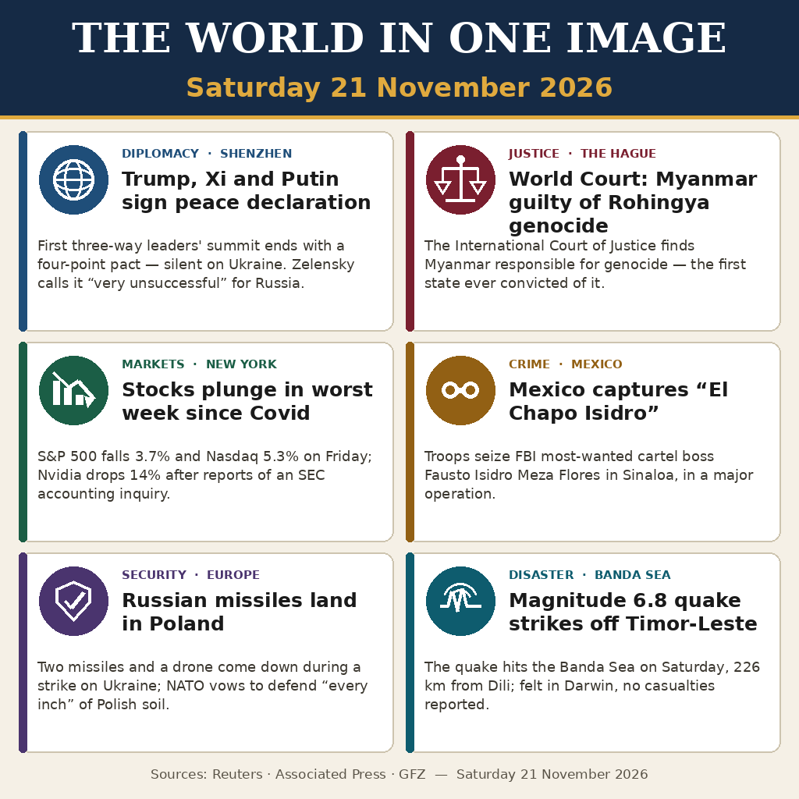

# The World in One Image — Saturday 21 November 2026

[](https://make.fun/bounty/news-image-20261121?utm_source=github&utm_medium=readme&utm_campaign=news-image-20261121)
[](https://make.fun/bounty/news-image-20261121/leaderboard?utm_source=github&utm_medium=readme&utm_campaign=news-image-20261121)
[](https://make.fun/bounty/news-image-20261121?utm_source=github&utm_medium=readme&utm_campaign=news-image-20261121)

A one-image summary of the world's news of **Saturday 21 November 2026**,
drawn as a newspaper front page: six stories, each with a pictogram, a
headline and a short deck.



## The six stories

1. **Diplomacy · Shenzhen** — Trump, Xi and Putin sign a four-point peace
   declaration at the first three-way leaders' summit; the pact is silent on
   Ukraine, and Zelensky calls it "very unsuccessful" for Russia.
2. **Justice · The Hague** — The International Court of Justice finds Myanmar
   responsible for genocide against the Rohingya, the first state ever
   convicted of genocide by an international court.
3. **Markets · New York** — Stocks plunge in the worst week since Covid: the
   S&P 500 falls 3.7% and the Nasdaq 5.3% on Friday, and Nvidia drops 14%
   after reports of an SEC accounting inquiry.
4. **Crime · Mexico** — Mexican forces capture FBI most-wanted cartel boss
   Fausto Isidro Meza Flores, known as "El Chapo Isidro", in Sinaloa.
5. **Security · Europe** — Two Russian missiles and a drone come down in
   Poland during a strike on Ukraine; NATO vows to defend "every inch" of
   Polish territory.
6. **Disaster · Banda Sea** — A magnitude 6.8 earthquake strikes the Banda Sea
   on Saturday, 226 km from Dili, Timor-Leste; felt in Darwin, with no
   casualties reported.

Facts verified against reporting by Reuters, the Associated Press and GFZ
on 21 November 2026.

## How to run it

`draw.py` renders the poster (Python 3 with Pillow and the system DejaVu
fonts, deterministic — no timestamps, no randomness, no network):

```sh
python3 draw.py   # writes entry.png, 1024x1024
```

`main.ts` (Node 22, standard library only) copies the shipped `entry.png`
to the output directory:

```sh
mkdir -p out && MAKEFUN_OUTPUT_DIR=out node main.ts
```

Running it twice produces byte-identical output.

## License

MIT — see [LICENSE](LICENSE).

---
Built for the [make.fun](https://make.fun/r/7nvvsk82) bounty
`news-image-20261121`. Try make.fun yourself:
https://make.fun/r/7nvvsk82
